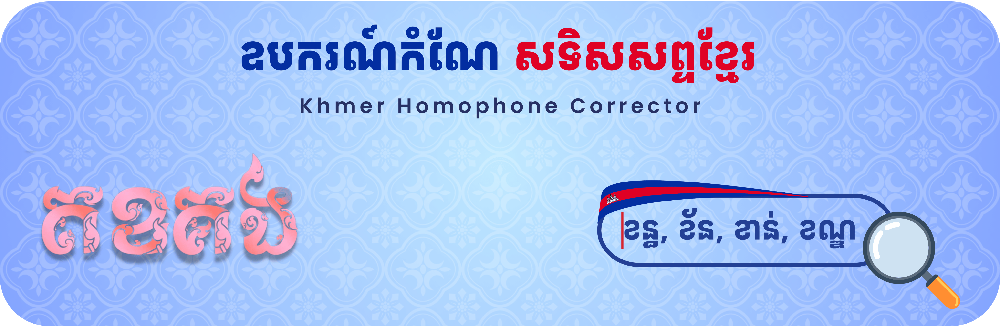

# Khmer Homophone Corrector

A web application for correcting homophone errors in Khmer text, built on the bachelor's thesis *Fine-Tuning PrahokBART for Khmer Homophone Error Correction Using a Sequence-to-Sequence Approach* (Paragon International University, Cambodia, 2025). The model is PrahokBART fine-tuned to rewrite a sentence containing a homophone error into its correct form.



## 🌟 Features

- **Real-time Khmer text correction**: Input Khmer text and get instant homophone corrections
- **Deep learning model**: A fine-tuned PrahokBART model trained specifically for Khmer homophone correction
- **Interactive UI**: Clean, user-friendly interface with real-time processing
- **Comprehensive homophone database**: Includes 268 homophone groups for reference
- **Correction highlighting**: Shows exactly what changes were made to your text
- **Word segmentation**: Khmer word tokenization with khmer-nltk

## 🚀 Live Demo

Visit the live application: [Khmer Homophone Corrector](https://khmerhomophonecorrector.streamlit.app)

## 📊 Results

Seven configurations were fine-tuned and evaluated with BLEU-4 and word error rate (WER):

| Model | Batch size | Epochs | Train loss | Val loss | BLEU-4 (%) | WER (%) |
|---|---|---|---|---|---|---|
| PrahokBART-base | 8 | 10 | 0.0170 | 0.0281 | 97.97 | 0.95 |
| PrahokBART-base | 16 | 10 | 0.0567 | 0.0524 | 96.30 | 1.46 |
| PrahokBART-base | 32 | 10 | 0.1061 | 0.0945 | 93.86 | 2.17 |
| PrahokBART-big | 8 | 10 | 0.0268 | 0.0291 | 97.97 | 0.95 |
| PrahokBART-big | 16 | 10 | 0.0380 | 0.0357 | 97.28 | 1.20 |
| PrahokBART-big | 32 | 10 | 0.0484 | 0.0470 | 96.62 | 1.42 |
| **PrahokBART-big** | **32** | **40** | **0.0091** | **0.0235** | **98.49** | **0.80** |

PrahokBART-big with batch size 32 and 40 epochs was selected as the final model.

**Reading these numbers:** each erroneous input differs from its target by only one or a few words, so overlap-based scores such as BLEU and WER are naturally high. Error analysis in the thesis found three main failure types:

- **Overcorrection**: the model sometimes changes words that were already correct.
- **Confusion within homophone groups that share meaning**: for example ចន្ទ / ចន្រ្ទ (both "moon") and អ្នក / នាក់.
- **Missed corrections in short or conversational sentences**: these give too little context to decide.

## 🗂️ Dataset

- **Homophone sets**: 268 sets of 2–5 words each, compiled from two Khmer homophone references (ជំនួយស្មារតី ពាក្យសូរដូចនិងពាក្យសូរលឿ, 2019; សទ្ទានុក្រម សទិសសូរ, 2013) with advice from native speakers.
- **Text**: more than 25,000 articles collected with Scrapy from 32 publicly accessible Khmer websites (news, health, education and others).
- **Preprocessing**: cleaning, Unicode normalization (khnormal), and sentence segmentation with khmer-nltk. Only sentences containing a known homophone were kept.
- **Error generation**: rule-based substitution with another word from the same homophone set gives (incorrect → correct) sentence pairs, split 80/10/10 into train/validation/test.

The training data is not included in this repository.

## ⚙️ Training Setup

Hugging Face Transformers and PyTorch on Google Colab (NVIDIA A100):

| Setting | Value |
|---|---|
| Maximum sequence length | 128 |
| Learning rate | 3e-5 |
| Weight decay | 0.01 |
| Warmup ratio | 0.1 |
| Precision | fp16 |
| Evaluation | at the end of each epoch |

## 📋 Prerequisites

- Python 3.8 or higher
- pip package manager

## 🛠️ Installation

### Local Setup

1. **Clone the repository**:
   ```bash
   git clone https://github.com/SocheataSokhaChan22/khmerhomophonecorrector.git
   cd khmerhomophonecorrector
   ```

2. **Install dependencies**:
   ```bash
   pip install -r requirements.txt
   ```

3. **Run the application**:
   ```bash
   streamlit run app.py
   ```

4. **Open your browser** and navigate to `http://localhost:8501`

## 📦 Dependencies

- `streamlit` - Web application framework
- `transformers` - Hugging Face transformers library
- `torch` - PyTorch for deep learning
- `khmer-nltk` - Khmer natural language processing

## 🎯 Usage

1. **Input Text**: Type or paste your Khmer text in the input area
2. **Process**: Click the "🔄 Correct Text" button
3. **View Results**: See the corrected text and any changes made
4. **Reference**: Browse the homophone examples to understand what can be corrected

## 🔧 How It Works

The application uses the fine-tuned PrahokBART model. PrahokBART uses the mBART architecture, so it loads as `MBartForConditionalGeneration`.

1. **Text Preprocessing**: Input text is segmented using Khmer word tokenization
2. **Model Processing**: The model reads the whole segmented sentence
3. **Correction Generation**: The model rewrites the sentence with the correct homophones
4. **Difference Detection**: Changes are highlighted and explained to the user

## 🤖 Model Information

- **Base model**: PrahokBART (mBART architecture, loaded as `MBartForConditionalGeneration`)
- **Task**: Sequence-to-sequence sentence rewriting (incorrect → correct)
- **Training data**: Khmer homophone sentence pairs (see Dataset above)
- **Hosted on**: Hugging Face Hub, [`socheatasokhachan/khmerhomophonecorrector`](https://huggingface.co/socheatasokhachan/khmerhomophonecorrector)

## 📚 Research Citation

This project builds on:

**PrahokBART: A Pre-trained Sequence-to-Sequence Model for Khmer Natural Language Generation**
- Authors: Hour Kaing, Raj Dabre, Haiyue Song, Van-Hien Tran, Hideki Tanaka, Masao Utiyama
- Published: COLING 2025
- Paper: [https://aclanthology.org/2025.coling-main.87.pdf](https://aclanthology.org/2025.coling-main.87.pdf)
- GitHub: [https://github.com/hour/prahokbart](https://github.com/hour/prahokbart)
- Hugging Face: [https://huggingface.co/prajdabre/prahokbart](https://huggingface.co/prajdabre/prahokbart)

To cite this project:

```bibtex
@thesis{chhea2025khmerhomophone,
  title       = {Fine-Tuning PrahokBART for Khmer Homophone Error Correction Using a Sequence-to-Sequence Approach},
  author      = {Chhea, Morita and Sokhachan, Socheata},
  type        = {Bachelor's thesis},
  institution = {Paragon International University},
  address     = {Phnom Penh, Cambodia},
  year        = {2025}
}
```

## 🌐 Deployment

### Streamlit Cloud

This application is deployed on Streamlit Cloud:

1. **Automatic Deployment**: Changes pushed to GitHub are automatically deployed
2. **Live Updates**: The app updates within minutes of code changes
3. **Scalable**: Handles multiple users simultaneously

### Manual Deployment

To deploy on your own Streamlit Cloud instance:

1. Fork this repository
2. Connect your GitHub account to Streamlit Cloud
3. Deploy using the repository URL
4. Set the main file to `app.py`

## 📁 Project Structure

```
khmerhomophonecorrector/
├── app.py                 # Main Streamlit application
├── requirements.txt       # Python dependencies
├── homophone_test.json    # Homophone database
├── header.png             # Application header image
├── LICENSE                # MIT License
└── README.md              # Project documentation
```

## 🤝 Contributing

Contributions are welcome! Please feel free to submit a Pull Request.

## 📄 License

This project is licensed under the MIT License. See [LICENSE](LICENSE).

## 👥 Authors

**Socheata Sokhachan**: model fine-tuning, web application and deployment
- GitHub: [@SocheataSokhaChan22](https://github.com/SocheataSokhaChan22)
- Project Website: [Khmer Homophone Corrector](https://sites.google.com/paragoniu.edu.kh/khmerhomophonecorrector/home)
- Hugging Face: [socheatasokhachan/khmerhomophonecorrector](https://huggingface.co/socheatasokhachan/khmerhomophonecorrector)

**Morita Chhea**: thesis co-author

Supervised by Soklay Heng, M.Sc. (Supervisor) and Rottana Ly, Ph.D. (Co-supervisor), Paragon International University.

## 🙏 Acknowledgments

- The PrahokBART authors for the pretrained Khmer model
- Hugging Face for the transformers library
- Streamlit for the web framework
- The Khmer NLP community for language resources

---

**Note**: This application is designed specifically for Khmer language homophone correction and may not work optimally with other languages.
